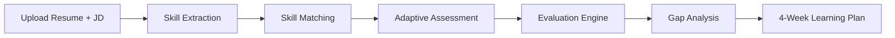

# AI-skill-assessment-agent
# 🚀 SkillScope AI

### Transforming resumes into **real skill intelligence**

> SkillScope AI converts static resumes into dynamic, AI-driven skill assessments — helping users **prove**, not just claim, their abilities.

---

## 🌟 Overview

**SkillScope AI** is an end-to-end intelligent system that:

* Extracts skills from resumes and job descriptions
* Evaluates candidates through adaptive questioning
* Identifies skill gaps
* Generates personalized 4-week learning plans

It bridges the gap between **what candidates say** and **what they can actually do**.

---

## 🎯 Key Features

### 📄 Smart Resume & JD Analysis

Automatically extracts and structures skills using LLMs.

### 🎯 Intelligent Skill Matching

Compares resume vs job description to identify:

* ✅ Matching skills
* ❌ Missing skills
* ⚠️ Weak areas

### 🧠 Adaptive Skill Assessment

Evaluates users through 5 cognitive dimensions:

* Comprehension
* Application
* Decision Making
* Logical Reasoning
* Scenario-Based Thinking

### 📊 Visual Performance Insights

* Skill-wise scoring (0–10) with a colour-coded bar chart
* Strengths and improvement points for each answer
* Downloadable Markdown report

### 🔍 Gap Analysis Engine

Ranks skill gaps based on importance and impact.

### 🧭 Personalized Learning Roadmap

Generates a **4-week structured plan** with:

* Learning resources
* Time estimates
* Practical tasks

---

## ⚡ How It Works




### 🧠 Behind the Scenes

1. LLM parses resume & job description
2. Skills are normalized and categorized
3. Gap analysis prioritizes missing competencies
4. AI generates scenario-based questions
5. Responses are evaluated using structured scoring
6. Personalized roadmap is generated

---

## 🛠️ Tech Stack

| Layer         | Technology                      |
| ------------- | ------------------------------- |
| Frontend      | Streamlit                       |
| Backend       | Python 3.10+                    |
| AI Engine     | Claude Haiku 5.5 (via OpenRouter) |
| PDF Parsing   | PyPDF2                          |
| Visualization | Altair                          |
| Deployment    | Streamlit Cloud                 |

> Note: OpenRouter is used via the OpenAI-compatible SDK.

---

## 📦 Installation

```bash
# Clone the repository
git clone https://github.com/<your-username>/skilloscope-ai.git

# Navigate to project
cd skilloscope-ai

# Create virtual environment
python -m venv venv

# Activate environment
# Windows:
venv\Scripts\activate
# Mac/Linux:
source venv/bin/activate

# Install dependencies
pip install -r requirements.txt
```

---

## 🔑 Configuration

Create a `.streamlit/secrets.toml` file:

```toml
OPENROUTER_API_KEY = "your_api_key_here"

# Optional: use a different OpenRouter model (default: anthropic/claude-haiku-5.5)
# OPENROUTER_MODEL = "anthropic/claude-sonnet-5.5"
```

The UI theme lives in `.streamlit/config.toml`.

---

## 🚀 Usage

```bash
streamlit run app.py
```

### Steps:

1. Upload a resume (PDF/TXT) or paste its text
2. Paste the job description
3. Analyze skills to see matching and missing skills
4. Pick the skills to assess (or use the JD skills), then start the assessment
5. Answer one scenario-based question per skill before the timer runs out
6. View scores, gap analysis and your 4-week learning plan

---

## 📊 Sample Output

### Skill Evaluation

```
Python: 8/10 → Strong fundamentals, needs async improvement
Kubernetes: 3/10 → Requires Docker foundation first
```

### Gap Priority

```
Kubernetes > CI/CD > Monitoring
```

### Learning Plan

```
Week 1: Docker Basics (4h)
Week 2: Kubernetes Fundamentals (6h)
Week 3: Hands-on Project (8h)
Week 4: Certification Prep (5h)
```


## 💼 Use Cases

* 🎓 Students preparing for placements
* 💻 Developers upskilling strategically
* 🔄 Career switchers planning transitions
* 🧑‍💼 Recruiters screening candidates

## 🌟 What Makes This Project Unique

* 🔁 Converts resumes into **interactive evaluations**
* 🧠 Uses **scenario-based assessment**, not MCQs
* 📊 Combines **analysis + evaluation + learning**
* 🎯 Focuses on **actionable improvement**, not just scoring
* 🔗 End-to-end pipeline: *Resume → Assessment → Growth*

---
## 📂 Project Structure

```
skilloscope-ai/
│
├── app.py
├── requirements.txt
├── .streamlit/
│   ├── config.toml      # UI theme
│   └── secrets.toml     # API key (not committed)
└── README.md
```

## 🧪 Testing

```bash
# Check the app compiles
python -m py_compile app.py

# Run it locally and walk through the flow
streamlit run app.py
```

If the AI steps fail, the app shows the reason (invalid key, no credits, unavailable model, rate limit).
---
## 🌐 Deployment

### Streamlit Cloud (Recommended)

1. Push code to GitHub
2. Deploy via Streamlit Cloud
3. Add API key in secrets

## 🤝 Contributing

Contributions are welcome!

```bash
git checkout -b feature/new-feature
git commit -m "Add new feature"
git push origin feature/new-feature
```

## 🙌 Acknowledgements

* Streamlit – UI framework
* OpenRouter – LLM access
* Claude – reasoning engine
* PyPDF2 – document parsing

> This project is built for developers who want to **demonstrate real capability**, not just list skills on a resume.

